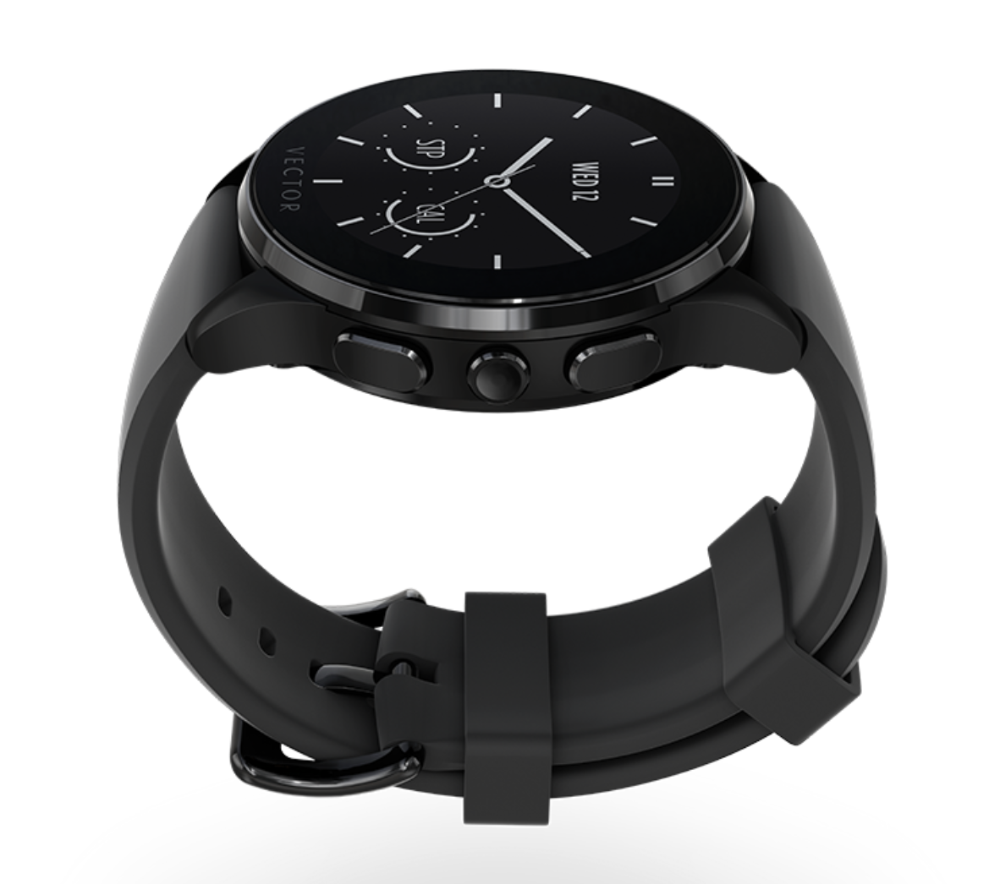
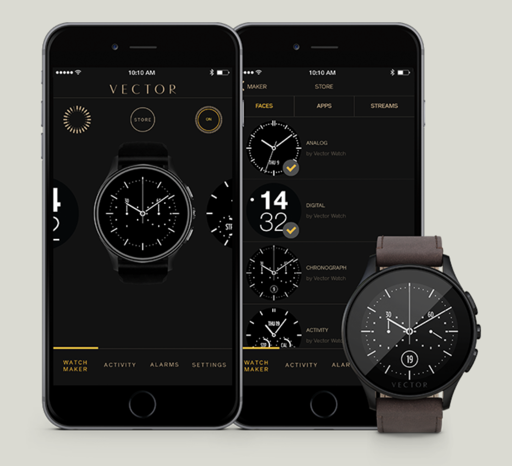
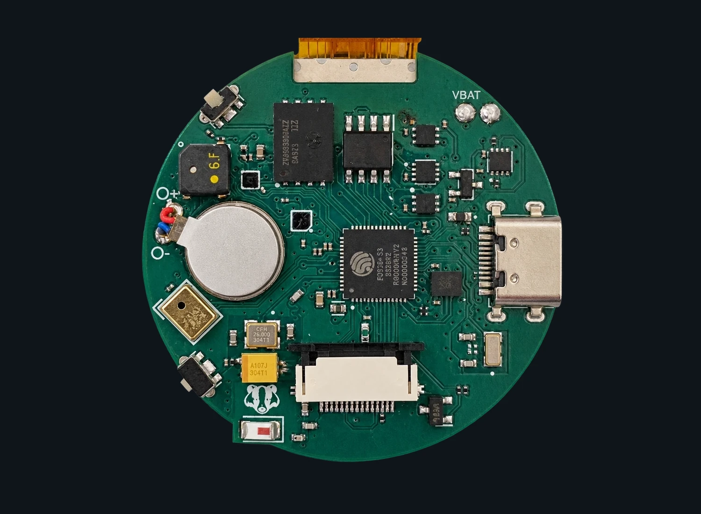
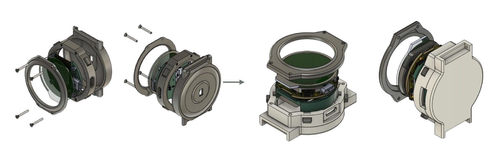
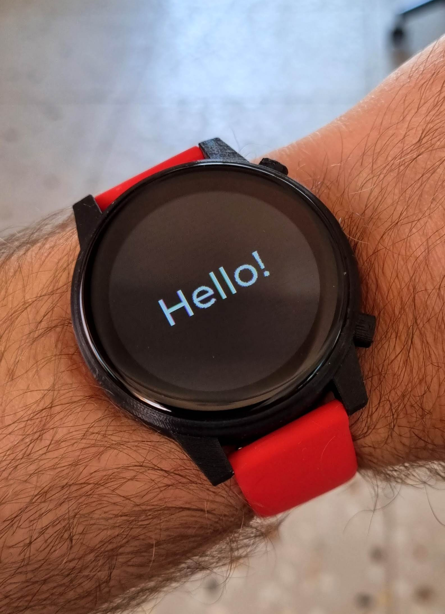
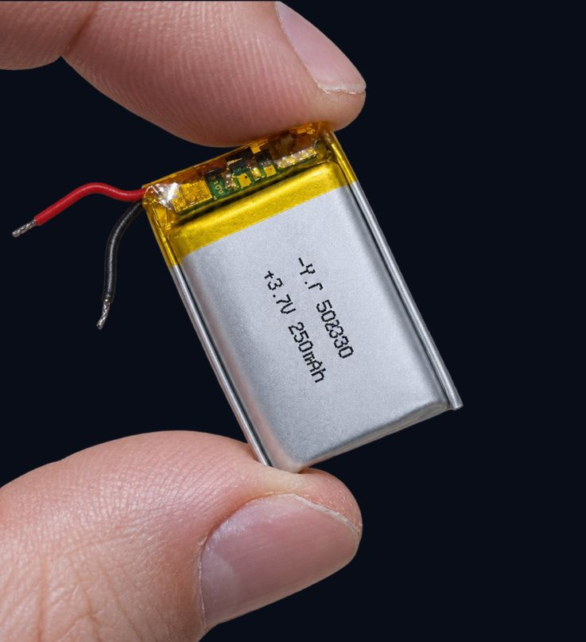
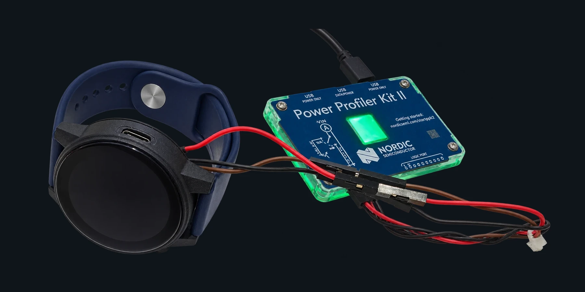
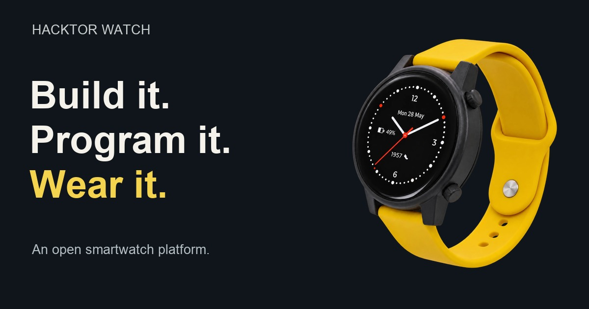

Ten years ago I worked for a start-up named Vector Watch. We were building an exceptional smartwatch: a stylish one, with 30 days of battery life.




It took about thirty of us. There were people on the hardware, on the firmware, on the mobile apps, and on the cloud and back-end services behind them.

Ten years on, I have built another one. This time there were two of us: me and one of my students, [Radu Pascale](https://github.com/radupascale), who designed the hardware. The goal was different, too: a smartwatch that is open from end to end, so that anyone can take it apart, change it and build on it. We called it Hacktor Watch.

## Why build another one

The first reason was practical. We run a lot of experiments in the lab, and they need raw data from the wrist: the samples themselves, with timing we know, processed the way we choose. Steps, calories and distance are not enough. Most smartwatch companies don't give you that data, and when they do, it comes through an API that is clumsy and doesn't necessarily return what you need.

The second was control. To develop a new application, or to improve an existing one, you sometimes need to change the hardware underneath it. You can't do that with a regular smartwatch, because the ecosystem is closed.

The third was that building a smartwatch is a lot of fun. And I was curious: ten years later, how much effort would it take?

Far less, it turns out. To be fair, what the two of us built is not a production device, and I wouldn't start selling it tomorrow. But it works, and we can offer it as a development kit.

So we made everything open. You can adapt the electronics, own the whole path your data takes through the firmware, and rework the case until it fits.

## What goes into one

At the heart of the watch is an ESP32-S3, a dual-core processor that is popular for good reasons: it is cheap, it is mostly low power, and it can run a lot of software. Around it we put off-the-shelf parts. There is a round color display with a touch screen, 240 by 240 pixels. There is a motion sensor. There is a microphone and a speaker, for a voice assistant or for coaching. And there is Wi-Fi and Bluetooth Low Energy to talk to a phone.



## The case is part of the design

The case turned out to be a big deal. I am not a mechanical engineer and I don't do 3D modeling, and neither does Radu.

It took us several iterations to get a design that used the space inside well and still looked good. Thickness matters a lot. If the watch is too thick, it doesn't look good on your wrist. If it is too thin, there is no room for a decent battery, or for much else. We had to settle on a compromise: an early version of the enclosure was 20.5 mm thick, and we brought it down to 18.



<figure class="narrow">
  <video controls muted loop playsinline preload="metadata" data-autoplay width="960" height="1200" poster="/media/hacktor-watch/case-animation-poster.webp" aria-label="3D animation: the Hacktor Watch runs its analog face, rotates face-up and opens into an exploded view of its case and internal layers.">
    <source src="/media/hacktor-watch/case-animation.mp4" type="video/mp4" />
  </video>
  <figcaption>The case we ended up with, opening into its layers.</figcaption>
</figure>

## First, make it say hello

We sent the design to China for manufacturing. When the first prototypes came back we were very excited, and the first thing we made the watch do was say hello.

{.narrow}

It is one word on a screen, but a lot has to work before it appears: the power supply, the buses, the drivers, and a small application on top.

## More software to choose from

The other thing that changed in ten years is the software. There are now many platforms you can pick up and use right away.

Arduino is a good choice for getting started, although it doesn't scale very well as an application grows. Then there are real-time operating systems that are open source and easy to port to a new board. NuttX is one, Zephyr is another. Hacktor Watch runs all three.

Zephyr is the one I find most interesting. It is built for devices with little memory, little processing power and a tiny battery. It is open source, written mostly in C and hosted by the Linux Foundation, and you can think of it as a kind of Linux for very small devices.

What sets it apart is that you describe the hardware before you write any code. A devicetree file says what is connected to the processor. Telling Zephyr that there is a motion sensor on the I²C bus takes this much:

```c
&i2c1 {
  status = "okay";
  imu: lsm6dsl@6a {
    compatible = "i2c-device";
    reg = <0x6a>;
  };
};
```

A second file switches on the pieces of software you need, such as the display, the graphics library and the Bluetooth stack. After that comes the application itself.

As an example, we wrote a small step tracker. It counts your steps, shows them on a watch face, sends them to your phone, and takes the current time from the phone. The whole project is three source files, the devicetree overlay and the configuration file.

It can be that small because most of the work is done elsewhere. The motion sensor counts the steps on its own, which uses far less power than doing it on the processor. The watch face is a few lines and labels drawn with LVGL. And the phone link is two Bluetooth characteristics: the phone writes the time to one and reads the steps from the other.

## Everything has a cost

The battery in the watch holds 250 mAh. The one in your phone holds at least ten times more.

{.narrow}

So the watch spends most of its time with things switched off. The display is dark when you are not looking at it; tilt your wrist and it comes on for ten or fifteen seconds. Inside the design there are switches that software controls, so the motion sensor, the microphone and the speaker are powered only when they are needed.

Memory is just as limited. Suppose you wanted to keep the raw data from the motion sensor: six channels, three for acceleration and three for rotation, at a hundred samples per second. That is 4.32 MB every hour. Writing it to flash costs power, and then you have to get it off the watch. Bluetooth Low Energy is a very, very thin straw, and an hour of recording could take thirty minutes or more to download.

So you don't do that. You process the data on the fly and save only what is interesting: count the steps, save the count. If you have ever worried that your smartwatch tracks your every move, it doesn't do it like that. It doesn't have the space.

Even pixels have a price. The processor has 512 kB of RAM, half a megabyte. One full frame for the display takes about 115 kB of that, so every animation and transition has to fit in what is left.

The only way to stay within these limits is to measure. We hook the watch up to a power profiler, and every software release gets profiled. It is not enough for the firmware to run properly and pass its tests. Battery life has tests of its own.



There is room for some fun, too. The processor is powerful enough to run a very small machine learning model, and we managed to run wake-word detection on it with TensorFlow Lite Micro. You say something like "Hello, watch" and it wakes up. A real voice assistant is probably possible as well, with some help from the phone.

## What the build taught us

Three things.

**Mechanics changes the system.** The enclosure, the layout and the assembly belong in the design from the start. A watch has to work, but it also has to look good and sit well on your wrist, or you won't want to wear it.

**Every feature has several costs.** Samples, pixels and packets all draw on the same budget of memory, processing power and battery. On a phone, a feature that needs a few hundred megabytes of RAM is nothing. On the watch, that is many times more memory than the whole device has.

**Working firmware still needs measuring.** Whenever you build something new, you measure it and profile it, and if the numbers don't fit you go back to the drawing board.

Ten years ago it took thirty of us to build a smartwatch. This one took two, and it is open for anyone to take further.

## The technical details

I have left the specifications for last, because they all live at [hacktorwatch.com](https://hacktorwatch.com): the hardware block by block, the three software stacks, and a guide for getting started.

[](https://hacktorwatch.com)

In short, it is an ESP32-S3 with 32 MB of flash and 8 MB of PSRAM, a 1.28-inch touch display, a six-axis motion sensor, a microphone, a speaker, haptics, Wi-Fi and Bluetooth Low Energy, with firmware for Arduino, NuttX and Zephyr.

- **Website:** [hacktorwatch.com](https://hacktorwatch.com)
- **Hardware, case and firmware:** [github.com/hacktorwatch/Hacktor-Watch-2.0](https://github.com/hacktorwatch/Hacktor-Watch-2.0)
- **Getting started:** [the guide on the project site](https://hacktorwatch.github.io/getting-started.html)
- **On this site:** the [Hacktor Watch project page](/projects/hacktor-watch/)

This article grew out of a talk I gave at DevCon 2026, *When Software Meets Hardware: Lessons from Building a Smartwatch*.
