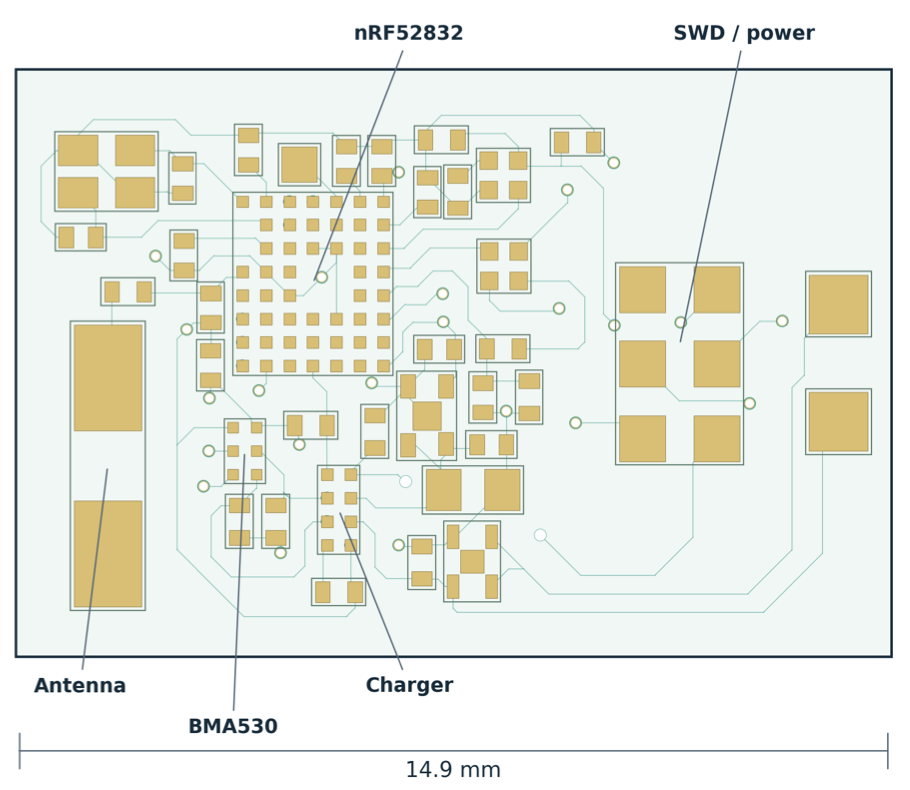
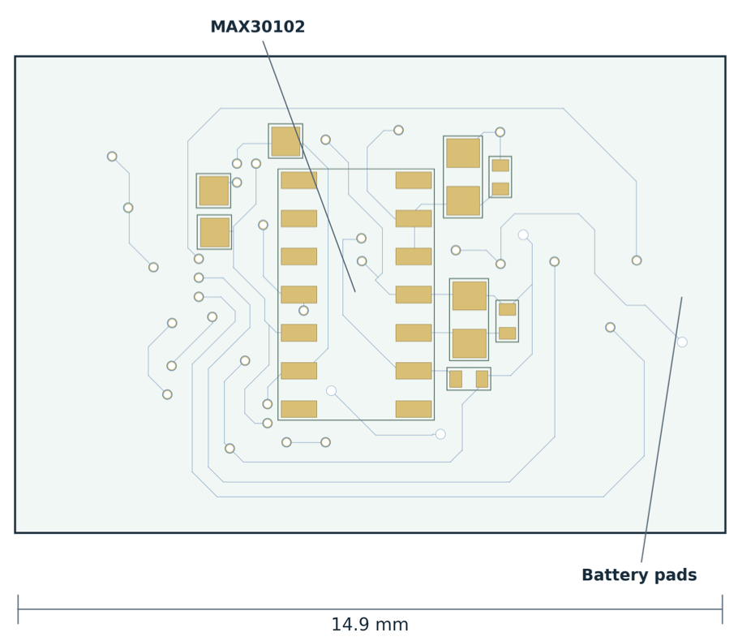
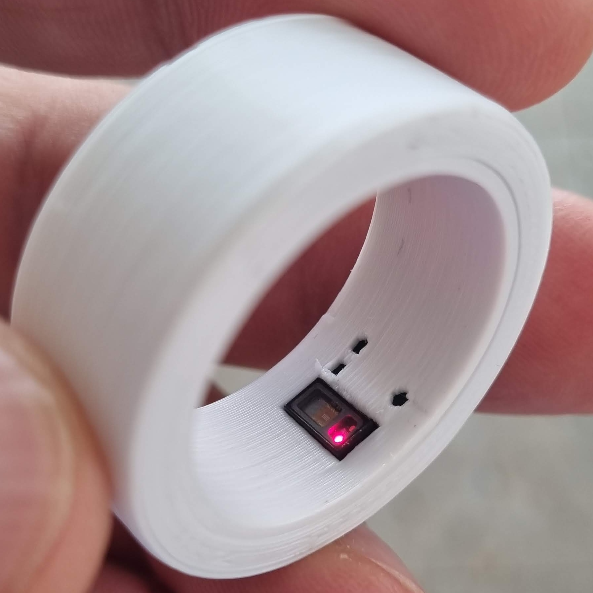
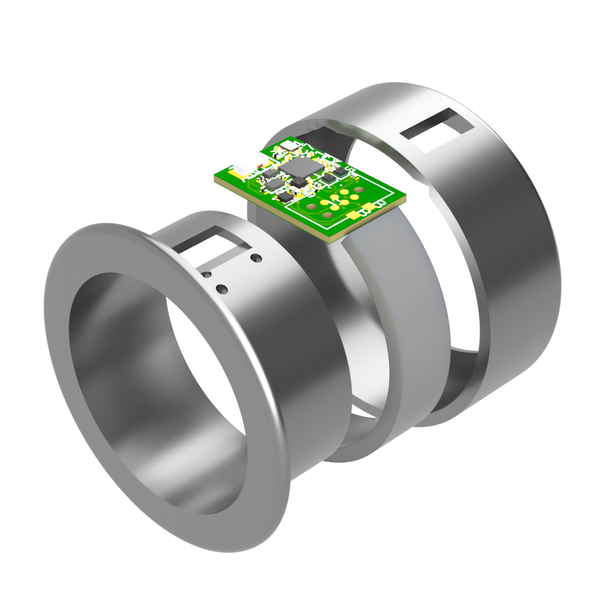
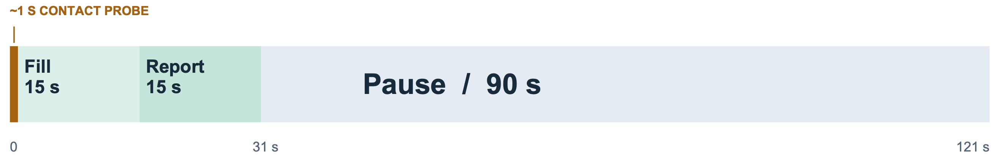
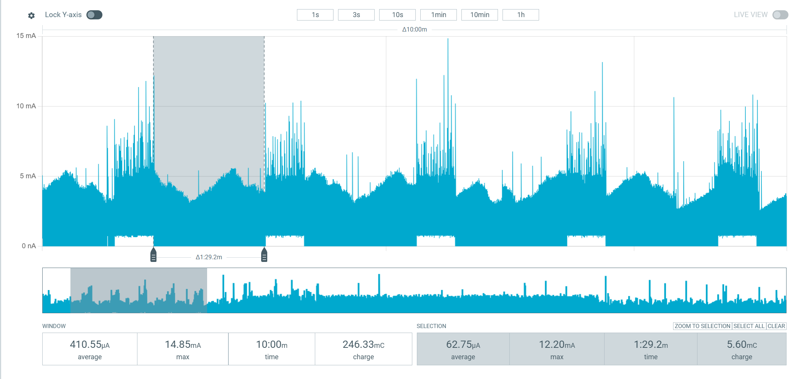

When I wrote about [building Hacktor Watch](/articles/building-hacktor-watch/), I pointed out that its battery holds 250 mAh, at most a tenth of what a phone has. The battery in SenseRing holds 31.

SenseRing is an open-source smart ring. It measures your pulse with light and your movement with an accelerometer, keeps a history of what it measured, and sends that history to a phone over Bluetooth. It began as an idea after a student hackathon. Today it is a working prototype, and the electronics, the enclosure, the firmware and the phone app are all published.

I designed the hardware and the enclosure. The Zephyr firmware on the ring and the app on the phone are the work of one of my students, [Dumitru Cavescu](https://github.com/CavAndDImi).

That one number, 31 mAh, shaped almost every decision along the way.

## A question left over from a hackathon

The idea came after a student hackathon at InnovationLabs. We saw what a ring could do for collecting biomedical and activity data: pulse, steps, motion, and the context around them. A ring makes continuous sensing possible in a very small form.

What we needed was a platform that exposed the whole stack. We wanted to understand, and to be able to change, how the data was acquired, how it was processed and how it reached the phone. That is not the same as wanting a finished consumer device. An experiment may need a different sampling schedule, a different quality threshold or a different way of exporting data, and you can only change those if the layers that decide them are open.

So openness was part of the brief from the beginning, next to the sensing requirements. We set out to build a ring that other people can inspect, modify and use for their own experiments.

## Decide the job before choosing the parts

The first useful question was what the ring must do. We wanted optical signals for pulse experiments, and motion data for steps and activity. The ring has to keep its readings when no phone is around, and deliver them later in a form that keeps their quality visible. Bluetooth is the link to the phone.

The battery is too small to run every subsystem all the time, so the sampling policy became a requirement as well.

It also helps to be honest early about what a feature is. A feature name is not an accuracy result. The ring can produce an SpO₂ estimate, for example, while its calibration is still unfinished.

## What goes into a ring

The parts follow from those constraints. An nRF52832 is both the processor and the Bluetooth radio, with 512 KiB of flash and 64 KiB of RAM for everything. A MAX30102 does the optical sensing, with red and infrared light. A BMA530 accelerometer senses motion and counts steps in hardware. A BQ25180 handles charging. The battery is a curved cell that follows the shape of the ring, which makes it a mechanical choice as much as an electrical one.

Choosing a low-power sensor does not give you a low-power system. Some of the savings begin in the schematic. On this board, software can switch off two loads: the supply for the optical LEDs, and the divider that measures the battery voltage. A load that cannot be disconnected has to be paid for all the time, whether it is useful or not.

## 14.9 by 10 millimeters

All of this sits on a board of 14.9 by 10 millimeters, with two copper layers. The antenna needs its space. The optical sensor has to face the finger. The pads for programming take room that could have gone to parts.

Miniaturization does not remove difficulty. It moves it. The design uses 0201 passives and fine-pitch packages to fit, and that makes assembly, inspection and rework more demanding. A board can be complete on screen and still be hard to build or to diagnose.

The programming pads are a good example. They cost board area, but without them bring-up and recovery would be much harder. The repository even includes models for a programming fixture, because how you physically reach the board is part of the design.

## The enclosure is part of the sensor

The enclosure does more than hold the board. It decides where the optical sensor meets the finger, how the curved battery sits around the ring, and whether the whole thing can be assembled at all. Fit affects contact, and contact affects the optical signal. A wearable has to work as a physical object as well as a circuit.

## First power-on

When a dense board powers up for the first time, you prove one layer at a time. First the power rails and the debug connection. Then whether the chips answer on the bus. Then their identity. Only then do you ask whether the numbers make sense.

The accelerometer is a good example. Seeing its address on the bus tells you the chip is there. Seeing the values change when you move the board tells you that something responds. Neither proves that the scale is right. An accelerometer at rest should report about one g.

Checks like that catch real mistakes. Our earlier software assumed a BMA456, while the board carries a BMA530, with a different register map and a different way of reading the data.

## The battery writes the schedule

Dumitru built the firmware on Zephyr, through Nordic's nRF Connect SDK. That gave us the kernel, the Bluetooth stack, the hardware interfaces and flash storage, none of which had to be written for the ring. What Zephyr cannot do is choose when to sample, or decide whether an optical reading is worth keeping. That policy belongs to the application.

Here is the policy for a ring that is being worn. A contact check of about a second decides whether it is worth going on. Then the ring fills a fifteen-second window with optical samples, 25 per second, 375 in total. Over the next fifteen seconds it produces five results, one every three seconds, each from the newest fifteen seconds of signal. Then the LEDs go dark for ninety seconds.

The schedule decides more than energy use. Those five results come from windows that overlap by twelve seconds, so they are five views of nearly the same signal and should not be read as five independent confirmations.

Every reading also carries its quality. If the signal does not support a result, the ring records a refusal with the reason, so a gap in the data is never silent. The quality score is not a probability, though. The default threshold is 450 out of 1000, and that does not mean a 45 percent chance of being right.

Low power also depends on details you would not expect. The divider that measures the battery sits behind a switch. In our configuration the stock driver would have left that switch on, so the application controls it itself: enable, wait for it to settle, measure, disable, on the error paths too. I don't mean that as a criticism of the driver. A sleep call is not a power design, and you have to follow each rail all the way to the board.

## A reading has to survive the trip to the phone

Taking a measurement is only part of the job. The phone may be away, the link may drop, the app may restart. So the ring keeps its own history in flash. Each reading is a 16-byte record with its values, time, quality and context. There is room for 14,592 of them, about four days at the normal pace.

Delivery is where the order of things matters. The ring replays its records. The phone commits them to its database. Only then does the phone acknowledge them, and the ring can reclaim the space. If the link fails before the acknowledgement, some records arrive twice and the app has to recognize the duplicates. The other order would be much worse: the ring would free data that the phone never kept.

This is still a bounded buffer. Keep the phone away for long enough and the oldest page is dropped to make room. It also has a price. The flash it uses came from unused slots meant for over-the-air updates, so the current build cannot be updated over the air.

Sending must not disturb sampling either. A Bluetooth send can wait for buffers, so sampling runs in the main thread and the history replay runs in its own lower-priority queue, where a blocked send holds up nothing else.

On the phone, Dumitru's Android app, written in Flutter, acts as the ring's notebook. It shows heart rate, SpO₂, battery and today's steps, together with the age of the readings, and it charts three days of heart rate and seven days of steps. The age matters, because what you see is buffered history and not a live stream. Everything stays in a database on the phone. There is no account and no cloud.

## Measure the whole cycle

That was the plan. Here is the measurement. We replaced the battery with a power profiler and let the ring run its normal cycle for ten minutes, with the accelerometer on and Bluetooth advertising.

Sampling draws about 1.35 mA for 31 seconds. The pause draws about 70 µA for 90 seconds. Over the whole capture the average is 0.41 mA. Divide 31 mAh by that and you get about 75 hours, a little over three days.

I want to be careful with that number. It is a projection for one operating condition. It is not a controlled discharge test, and it says nothing about runtime with a phone connected. It did replace an earlier estimate of 305 µA, which had promised four days. The next useful experiment is a discharge test on a ring that is being worn.

## What still does not work

A working prototype still has open questions, and I would rather list them than hide them.

SpO₂ is not calibrated against a reference for this optical arrangement. The thresholds and the step counts need much more testing on real fingers. SenseRing is a research prototype, not a certified medical device.

In testing, the ring reset about every 28 minutes. We have not found the cause yet. The history survives the reset, so at least the evidence is kept.

There is no over-the-air update. And the repository has the design sources but not a manufacturing-ready package: no Gerbers, no bill of materials, no pick-and-place files.

There was only one hardware revision, so the corrections so far have been in firmware. Besides the accelerometer mix-up, an early sampling loop slept longer than the optical sensor's buffer could hold, and lost data. The sleep interval had looked perfectly reasonable.

## What the build taught us

Four things.

**Choose the constraints before the parts.** The experiment you have in mind, the energy you have and the shape of the thing tell you what matters in a component.

**Design the layers together.** A problem with optical contact can begin in the enclosure. An idle-current problem can begin in the schematic. A delivery problem can begin in the order in which the app acknowledges data.

**Measure the claim you want to make.** A chip identity, a bus response, a plausible value, a current capture and a discharge test each answer a different question.

**Make the next step possible for someone else.** Sources are worth more when they come with their context, their limits and a way to repeat the experiment.

SenseRing reached working prototypes on its first hardware revision. What comes next is better evidence, better reliability and an easier way to reproduce it. If you have chased a reset or a power problem on a small Nordic wearable, I would like to compare notes.

## The technical details

As with the watch, I have left the specifications for last. They are on the project's site, [sense-ring.com](https://sense-ring.com), and in the repository.

In short, it is an nRF52832 with a MAX30102 optical sensor, a BMA530 accelerometer and a 31 mAh curved battery on a 14.9 × 10 mm board, with Zephyr firmware and an Android app.

- **Website:** [sense-ring.com](https://sense-ring.com)
- **Hardware, enclosure, firmware and app:** [github.com/Sense-Ring/Sense-Ring-1.0](https://github.com/Sense-Ring/Sense-Ring-1.0)
- **On this site:** the [SenseRing project page](/projects/sensering/)

This article grew out of two talks I gave about the ring: *From idea to an open wearable* at OmniOpenCon, and *Building a wearable with Zephyr* at a Zephyr meetup.
