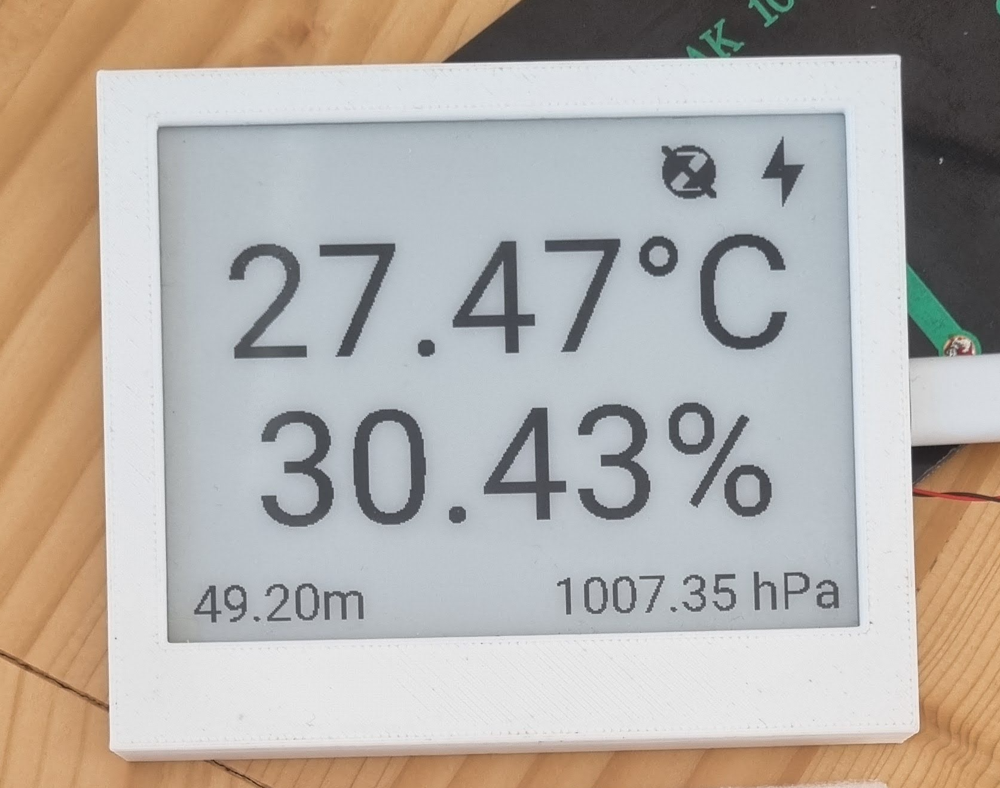
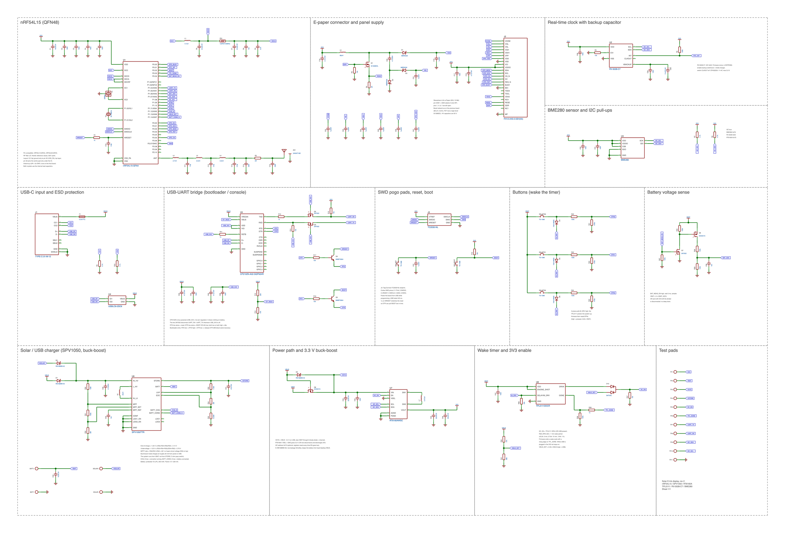
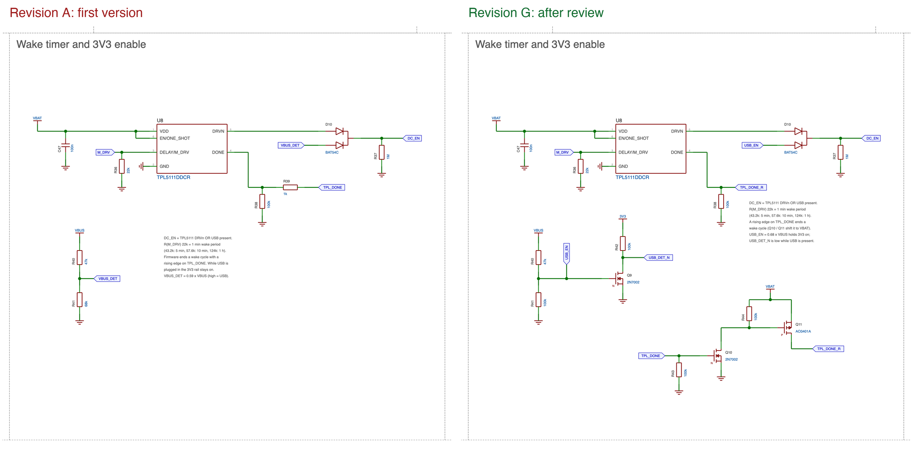
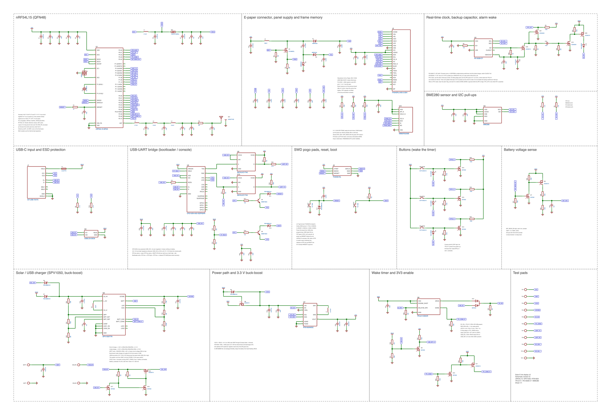
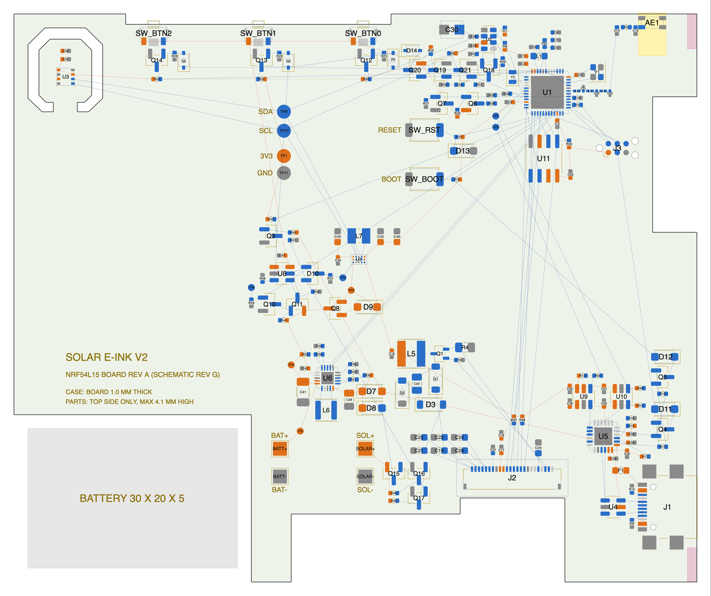
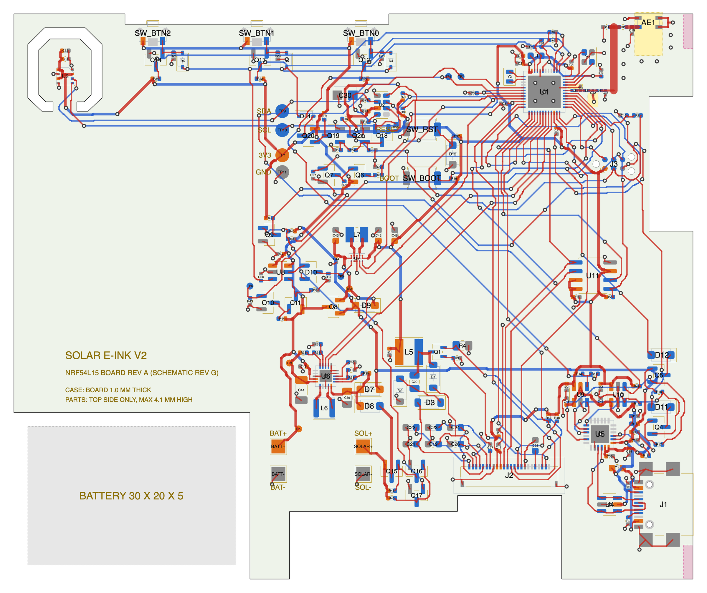
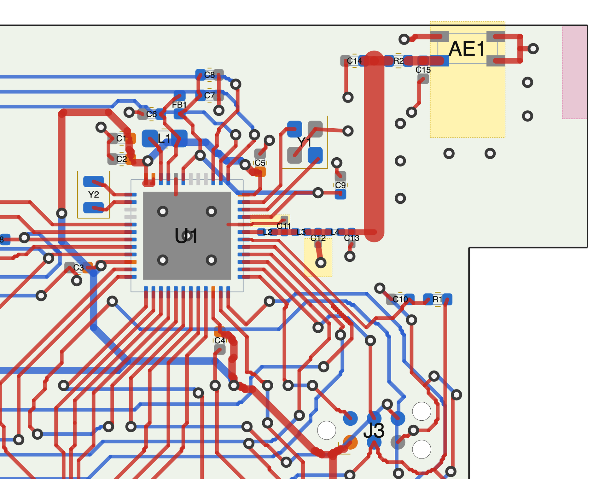

There is a small weather station on my desk. It has an e-paper screen and a solar panel, one of my students designed it, and for the past year it has quietly done its job without ever needing a battery recharge.

It also has a couple of documented flaws, and that gave me an idea for an experiment. I would hand the design to an AI and see whether it could spot them. Then I would ask it to design a better board, with a lower-power processor, an energy-harvesting circuit and an improved power path.

The AI was Claude (model Fable 5.2), running in Claude Code inside VS Code. I typed about two dozen prompts, and it worked for 7.7 hours. At the end I had a fully routed two-layer PCB.

Here is the short version. Its engineering reasoning and its self-checking were better than I expected. But it needed a lot of hand-holding, and ideas from me, to get to a complete design. Its first schematic had serious flaws and would not have worked. The routing was slow, and the result is flawed: a board that passes its electrical checks in theory, and that I would definitely not send to manufacturing.

## The hard road

I wanted to give the AI a challenge, so the design was made in Autodesk Fusion 360 Electronics, the successor to Eagle, and not in KiCad.

That was the hard road. The AI cannot drive Fusion, so it worked indirectly: it wrote Python programs that generate Eagle-format files, and I loaded each file into Fusion to look at it and check it. It never saw its own output in the real tool. Instead it validated every file against Eagle's XML schema and drew its own preview images. The toolchain it built for itself grew to about 5,900 lines of Python: a schematic generator, a board generator, a router and several checkers.

KiCad would have been the easy road. I have it installed on the same machine, and the clever bit was that the AI used it anyway, to get a second opinion on the routed board.

## It found the faults in two and a half minutes

I started by giving it the schematic PDF of the old device: an ESP32-C6 board with a Waveshare 4.2-inch e-paper screen and a 5 V, 230 mA solar panel.

The review took two and a half minutes, and it found both serious faults. The solar panel fed the battery through a diode, bypassing the charger chip, so the charging was unregulated. And the circuit that measures the battery stayed on during sleep and drew about 200 µA, far more than the sleep timer itself. It also pointed out two smaller things: a marginal USB wake circuit, and a weak transistor in the display's boost converter.

Then it listed what it had checked and found correct. The report was concise. I liked that.

## A schematic I could actually read

My brief for the new board was one paragraph:

- an nRF54L15 in a QFN package instead of the ESP32
- an SPV1050 harvester that charges a 250 mAh protected LiPo from both the solar panel and USB
- the same BME280 temperature and humidity sensor, RT6160 regulator, TPL5111 timer and 24-pin display connector
- all parts in stock at JLCPCB, with 0402 passives where possible
- programming through pogo pads or a USB bootloader
- output in Eagle format, so that I can import it into Fusion and run checks

It asked one clarifying question, about the real-time clock. Then it sent five research agents off to read datasheets and check JLCPCB stock while it wrote the generator. A little over an hour later I had a schematic: one sheet, 149 components, embedded footprints, and a BOM with JLCPCB part numbers.

And it was legible. I was not expecting that. Every earlier attempt I had made at getting an AI to draw a schematic ended in an unreadable mess. This one was organized into functional blocks, with named nets and firmware notes beside each block, much like the schematic of the old device I had given it as a reference.

## It would not have worked

Then I reviewed it, and found a series of flaws.

With USB plugged in and the MCU unpowered, an MCU pin clamped the USB-detect node, so USB alone could not start the board. The buttons, the USB-serial bridge and the timer's DONE line could all push current into chips that had no power. Diode-ORing the solar panel and USB did not guarantee that USB would actually charge the battery. And resistor tolerances let the end-of-charge voltage reach 4.237 V, a little over the 4.2 V the battery pack supports. That last one was minor, because the pack has its own over-voltage protection.

All of this came after the AI's own checks had passed. Those checks verified that the file matched its intent: the wires connect, and every pad matches the datasheet pinout. They did not verify that the intent was right.

## Six more revisions

Fixing the design took six more revisions over the next day, and about an hour of the AI's working time. I asked it to discuss each issue with me before touching the file. It checked the review's arithmetic, said plainly where it had been wrong, and then found two more faults of the same kind that the review had missed.

| Revision | Parts | What changed |
| --- | --- | --- |
| A | 149 | First complete schematic |
| B | 171 | Every power state made safe: separate USB-enable path, level translator, isolating buffers, panel-disconnect FETs so USB charging takes priority |
| C | 181 | The RTC alarm can wake the board |
| D | 182 | Reset circuit reworked around a documented nRF54L15 erratum; three status inputs moved to other pins |
| E | 182 | Parts matched to the old board: side-actuated buttons, USB and display connectors, slimmer inductors |
| F | 185 | 256 kbit SPI FRAM added, so the display can do partial refreshes after a cold boot |
| G | 185 | Footprint-only change for the PCB: larger test pads |

The erratum in revision D came from a second round of review. The AI's reset capacitor held the reset line low at power-up, which Nordic's errata sheet warns against. It fetched the errata pages, confirmed the conflict and reworked the circuit.

Every revision was regenerated from code, checked again, and compared net by net with the previous one, so that only the intended changes went in. The final schematic has 185 parts and 107 nets.

## Fitting the old case

The new board has to drop into the existing case, so for placement I gave it rules instead of a free hand. Copy the board outline from the old design. Keep the three buttons, the display connector, the battery and solar pads, and the BME280 with its cut-out where they were. Move the USB connector to the lower-right corner. Keep the SCL, SDA, 3V3 and GND test pads aligned, for a possible add-on board.

It read the outline and the reference positions straight from the old board file, and it wrote a checker that compares the kept positions, pad by pad, with the old board. Placement took 37 minutes of working time. It followed all my instructions, and I accepted it without changes.

Then I pointed it at the 3D model of the old case. It measured the STEP file with a CAD kernel and came back with constraints I had purposely not given it. Two retaining hooks reach over the board's right-hand corners, and one of them sat exactly where it had first put the USB connector. Parts can be at most 4.1 mm tall, and nothing can go on the bottom side. And the board in the model is 1.0 mm thick, not the 1.6 mm in the old rule file.

It moved the connector, marked the hooks as keep-out areas, and asked me to confirm the thickness and the layer count before routing. I chose 1.0 mm and two layers. Measuring the case model caught a connector collision before it ever reached the printer.

. The pink areas at the right-hand corners are the retaining hooks.")

## Routing, the hard part

Routing took 4.9 hours of working time. Everything before it had taken 2.8 hours combined. The board is small, but it has 185 parts, a 2.4 GHz antenna feed, and only two layers.

Its first plan was to use an open-source autorouter. The tool's permission system blocked that download, and the AI did not try to work around the block. Instead it wrote its own router in Python, a grid-based maze router for two layers that rips up tracks and retries them. The antenna feed and the fan-out of the MCU it laid out by hand, in code, following Nordic's layout notes for the radio.

Progress was uneven. Again and again the router got within one or two connections of finishing, and then cycled. A clean-up step of its own deleted pieces of track and broke four nets, which its own rule check caught. Sixteen ground pads ended up fenced in by signal tracks, with no room for a via. In the middle of all this the session hit my plan's 5-hour usage limit and paused for two hours. And when I asked how long it needed, it said 45 to 90 minutes. It needed about two and a half hours.

 still sits directly below the MCU, in the path of its fan-out.")

What finally worked was not more computation. It was two design decisions: it moved the FRAM out of the path of the MCU's fan-out, and it shrank the vias from 0.8 mm to 0.6 mm. After that the whole board routed in five minutes.

On paper, the result is complete: all 107 nets connected, 2,882 track segments, 282 vias, and a smallest clearance of 0.154 mm. It checked the board twice. Its own exact-geometry rule check passed. Then it imported the board into KiCad and ran KiCad's rule check with filled copper pours, which found no clearance violations and no unconnected items. It left the cosmetic warnings about silkscreen and solder mask alone.

Look closer, though, and the picture changes. The corner with the MCU and the radio is a disaster.

The radio circuit is a mess, even though the AI had access to the specifications for proper RF routing. The board as a whole is electrically complete but not hand-polished: it uses 282 vias, and some tracks meander. A proper autorouter or a patient human would definitely do better.

## What it was good at

Reading, checking, and being honest about its limits.

It read datasheets and errata instead of guessing. That is how it knew about the SPV1050's 30 mA limit in buck-boost mode and the supply-ramp limits of the FRAM, and how it avoided an I2C address clash. The schematic reads like one drawn by a careful colleague, and the BOM carries JLCPCB part numbers and stock warnings.

It wrote its own verification chain: schema validation, wire-to-pin connectivity, a pad-by-pad audit against datasheet pinouts, a net-by-net comparison between revisions, and an exact rule check for the PCB.

It owned its mistakes. When the review found the USB start-up bug, it said that its earlier claim about programming without a battery had been wrong.

And because the whole design is generated from code, it is reproducible. After a placement change, a full re-route and re-check takes about five minutes.

## Where it fell short

The first schematic looked right and passed every check the AI had written, and it still had a start-up lockout and several back-feeding paths. Its checks proved consistency, not correctness. It took two rounds of independent review to get to a design that holds up.

The routed board is severely flawed, and most likely unusable in its current form. Routing was also the slowest and most expensive step.

It had no eyes on the EDA tool. It could not open Fusion 360, so I was the loop for loading files and checking them, and its previews were its own drawings, not Fusion's.

It took more latitude than I gave it. I allowed it to move parts "slightly". It moved the RTC and battery-sense groups and the FRAM by about 18 mm, and the programming pads by 2.4 mm. It reported this itself, but only afterwards.

It has an appetite for tokens. About 300 million of them passed through the model, mostly its own context being read again. The conversation was summarized twice to fit, and my plan's usage limit stopped the work twice.

And nothing is proven in hardware. The antenna matching needs tuning on a real board, and the display's boost converter and the charger need bench checks. "Functional" here means that it survived review.

## Where this leaves me

An AI can now carry an electronics design from a paragraph of requirements to a routed board, including the unglamorous parts: reading datasheets, checking stock, and writing its own verification. That is where it can really help, by speeding up development and assisting an experienced engineer.

It is far from a smooth, fully automated process in which anyone can type a prompt and get a finished device. The field is moving quickly, and it is anyone's guess how things will look in a few months or a year. I can imagine models that design complex electronics, given proper training. The questions that remain are time and cost. Will it be faster and cheaper than a human? Probably not. Will an experienced engineer benefit from these tools? Definitely.

As for my design, I will most likely route the board by hand. I would not send the AI-routed board to manufacturing as it is. But I appreciate the time it saved me: it drew the schematic, pulled in all the component footprints, and cross-checked availability and stock at the manufacturer.

## The numbers

I have left the accounting for last. From the first prompt to the routed board, the project used 1.96 million generated tokens and 8.4 million tokens of new input, in 7.7 hours of AI working time. On the clock it took 25 hours and 11 minutes, from 21:57 on 12 November to 23:08 on 13 November 2026.

| Phase | AI working time | Model requests | Generated tokens | New input tokens | Cached re-reads |
| --- | --- | --- | --- | --- | --- |
| Review of the old design | 2 min | 1 | 14 k | 19 k | 0.03 M |
| First schematic (rev A) | 66 min | 478 | 912 k | 2.93 M | 107 M |
| Schematic revisions B to G | 63 min | 146 | 440 k | 3.74 M | 67 M |
| Placement and case fit | 37 min | 46 | 197 k | 0.31 M | 19 M |
| Routing | 294 min | 173 | 395 k | 1.39 M | 99 M |
| **Total** | **462 min (7.7 h)** | **844** | **1.96 M** | **8.39 M** | **292 M** |

Generated tokens are what the model wrote, including 1.26 million tokens of internal reasoning. New input is text it saw for the first time: my prompts, datasheets, files and tool output. Cached re-reads are the conversation being read again on each of the 844 requests, and they are billed at a fraction of the normal input rate. Counting everything, about 302 million tokens passed through the model.

Research agents made 482 of the 844 requests. They ran in parallel for about 170 minutes of agent time, which is not in the working-time column.

Of the 25 hours on the clock, the AI was working for 7.7, plus 44 minutes of waiting on background routing runs and research agents. For the other 16.7 hours it was waiting for me. That includes one night, and two pauses when my plan's 5-hour usage limit was reached.

A few things are not in these numbers. Web searches and page fetches ran on a smaller helper model, whose last logged count was 2.7 million tokens, part-way through day two. Claude Code's own notional cost counter, at API list prices, read $119 after the first 518 requests, and I do not have its final value.

The token counts are enough to estimate it, though. At the list prices for Fable 5.2, the generated tokens come to about $78 and the cached re-reads to about $58. New input costs between $8 and $16 per million tokens, depending on whether it is also written to the cache, which adds roughly $110. That puts the whole project at about $250.
