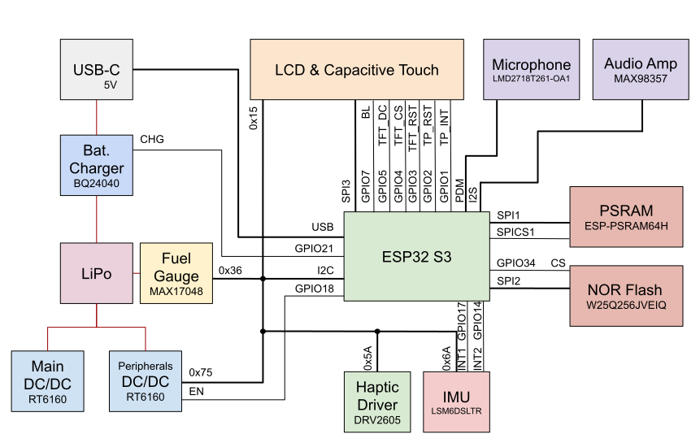

Hacktor Watch is an open hardware smartwatch with firmware you can shape. Start from the hardware design, or boot into Arduino, NuttX or Zephyr to prototype your own apps.

The project has its own website at [hacktorwatch.com](https://hacktorwatch.com), and the design files and firmware are on GitHub at [hacktorwatch/Hacktor-Watch-2.0](https://github.com/hacktorwatch/Hacktor-Watch-2.0).

## At a glance

| Subsystem | Spec |
| --- | --- |
| Processor | ESP32-S3, dual-core 240 MHz, Wi-Fi and BLE |
| Display | 1.28" color LCD, 240 × 240, capacitive touch |
| Memory | 32 MB external SPI flash, 8 MB PSRAM |
| Sensors | 6-axis IMU, microphone |
| Output | I2S amplifier and speaker, haptic driver |
| Power | 250 mAh LiPo, USB-C charging, fuel gauge |
| Software | Arduino, NuttX, Zephyr |

## Project areas

- **[Hardware](https://github.com/hacktorwatch/Hacktor-Watch-2.0/tree/main/Hardware)** — schematics and PCB design.
- **[Mechanical](https://github.com/hacktorwatch/Hacktor-Watch-2.0/tree/main/Mechanical)** — enclosure and assembly files.
- **[Arduino](https://github.com/hacktorwatch/Hacktor-Watch-2.0/tree/main/Software/Arduino)** — Arduino-compatible APIs to prototype quickly and teach.
- **[Zephyr](https://github.com/hacktorwatch/Hacktor-Watch-2.0/tree/main/Software/Zephyr)** — an RTOS application configured with Devicetree and Kconfig.
- **[NuttX](https://github.com/radupascale/hectorwatch-nuttx)** — a POSIX-friendly RTOS on the watch for real-time apps.
