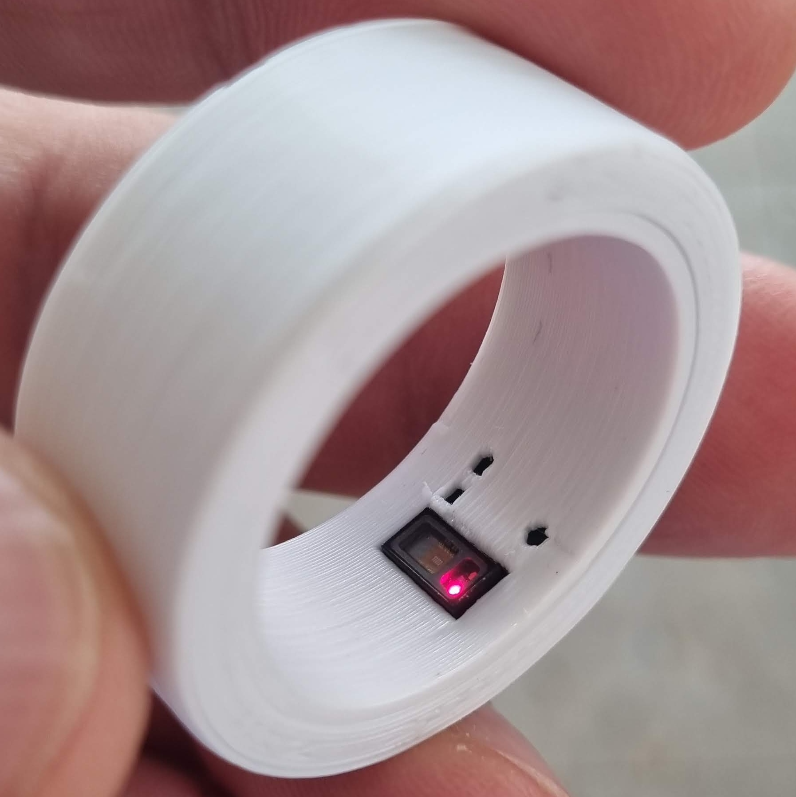
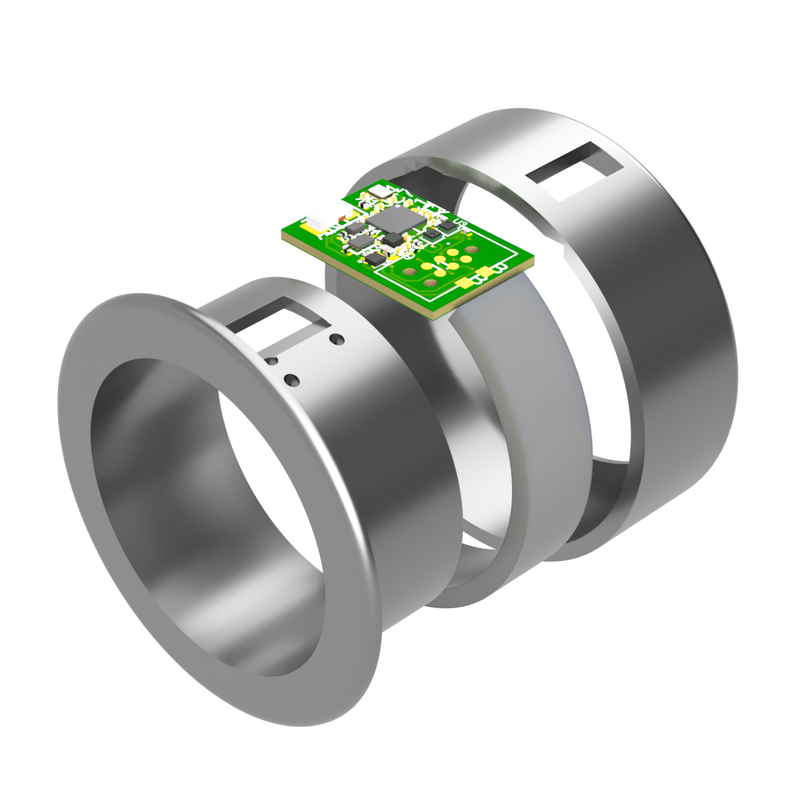
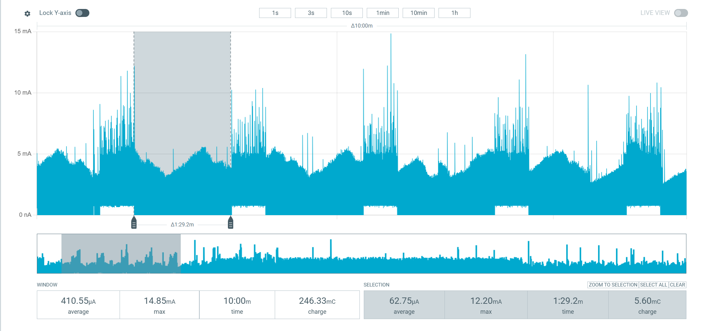

SenseRing is a compact, finger-worn research and development platform built around the Nordic nRF52832 Bluetooth Low Energy SoC. Its custom electronics combine optical pulse sensing, motion sensing, wireless connectivity, battery charging and power management in a ring.

Use it to explore photoplethysmography (PPG), heart-rate and SpO₂ algorithms, activity and gesture recognition, low-power Bluetooth applications and new wearable interfaces. The project has its own website at [sense-ring.com](https://sense-ring.com), and the electronics, the enclosure, the firmware and an Android app are all on GitHub at [Sense-Ring/Sense-Ring-1.0](https://github.com/Sense-Ring/Sense-Ring-1.0).

The hardware and the enclosure were designed by [Dan Tudose](https://github.com/dantudose). The Zephyr firmware and the Android app were written by [Dumitru Cavescu](https://github.com/CavAndDImi).

> SenseRing is an experimental research platform, not a certified medical device. Do not use it for diagnosis, treatment, or safety-critical monitoring.

## At a glance

| Subsystem | Spec |
| --- | --- |
| Processor | nRF52832, 64 MHz Arm Cortex-M4F with Bluetooth Low Energy |
| Optical sensing | MAX30102 red and infrared PPG sensor |
| Motion | BMA530 3-axis accelerometer with motion interrupts and step counting |
| Power | 31 mAh curved LiPo, BQ25180 charger, 1.8 V LDO |
| Board | 14.9 × 10 mm, two copper layers |
| Programming | TC2030 SWD footprint, also used for charging |
| Software | nRF52832 firmware and an Android companion app |

The processor talks to the PPG sensor, the accelerometer and the charger over a shared I²C bus, and each of them has its own interrupt line to wake the processor. The supply for the PPG LEDs and the divider that measures the battery can be switched off separately, which limits leakage when they are idle.

## Battery life

The ring was measured with a Power Profiler Kit II supplying the board in place of its 31 mAh cell. In its normal cycle it samples for 31 seconds and then sleeps for 90, with the accelerometer on and Bluetooth advertising throughout.

| Mode | Average load current | Duration |
| --- | --- | --- |
| Sampling (LED rail up) | 1.35 mA | 31 s |
| Sleep (IMU and BLE only) | 0.07 mA | 90 s |
| **Full cycle** | **0.41 mA** | **121 s** |

At that rate one charge lasts about 75 hours, a little over three days. Sampling continuously, it lasts about 23 hours.

## Project areas

- **[Hardware](https://github.com/Sense-Ring/Sense-Ring-1.0/tree/main/Hardware)** — schematic and board sources for Autodesk Fusion Electronics and EAGLE, and a schematic PDF.
- **[Mechanical](https://github.com/Sense-Ring/Sense-Ring-1.0/tree/main/Mechanical)** — the Fusion 360 assembly, STEP and OBJ exports, printable shells and a programming fixture.
- **[Firmware](https://github.com/Sense-Ring/Sense-Ring-1.0/tree/main/Software/Firmware)** — sampling, the vitals estimator, the flash log and the BLE peripheral.
- **[App](https://github.com/Sense-Ring/Sense-Ring-1.0/tree/main/Software/App)** — an Android companion app that collects the ring's buffered log over BLE, stores it locally and charts it.
